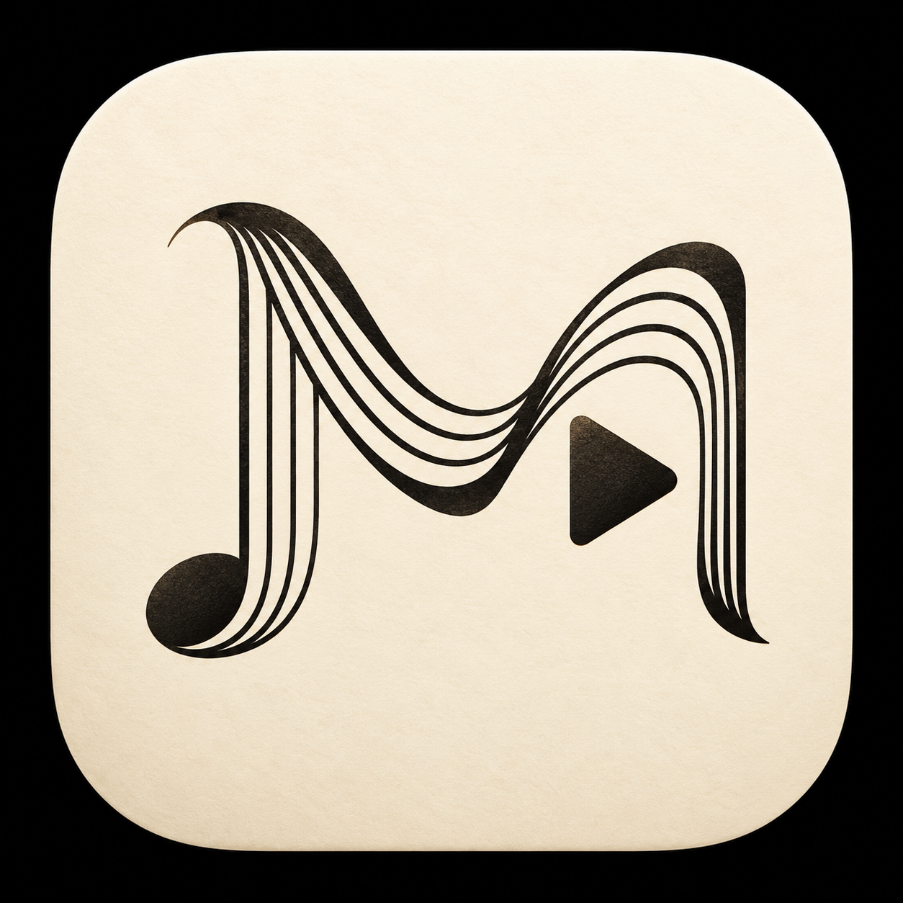

# Mov.

**Movement，乐章。** 同时呼应视频格式 `.mov`。

面向古典音乐与长视频音频的原生 Android 播放器，基于 Jetpack Compose 和 Media3，围绕 Bilibili 的作品、分P和长时间聆听体验设计。

<picture>
  <source media="(prefers-color-scheme: dark)" srcset="icon/mov-dark.png">
  
</picture>

## 播放与整理

- 三屏播放页：**作品 / 播放 / 队列**，默认进入中间页，可左右滑动或点击顶部标签。
- 左页查看作品信息、评论、详情、分享和收听统计；中间保留收藏、进度和主播放控制；右页提供队列、全部分P、随机、循环和定时关闭。
- 点收藏加入或移出“我喜欢的音乐”；长按选择其他本地歌单或新建歌单。
- 最近播放点播保留现有队列，已有曲目直接定位，新作品追加；主动播放整张歌单时切换上下文。
- UP 主投稿搜索支持关键词分页、清空恢复和失败重试。
- 支持后台播放、系统媒体控制、本地歌单、历史记录、下载和既有同步能力。
- Classical 构建关闭歌词处理、动态背景和音频可视化等开销，并优化长音频的缓冲、缓存争用和卡顿恢复。实际流畅度取决于网络、地区和源站。

## 安装与覆盖更新

主要构建仍使用 `classical` flavor，APK 名称为 `Mov-<version>-classical.apk`。

更名后保留安装 ID `moe.ouom.neriplayer.classical`、原有签名、数据目录、设置键、同步格式和深链。使用同一签名的新版可以直接覆盖安装，无需卸载，已有账号、歌单和设置会保留；平台登录自身到期时仍需认证。

应用内标志跟随明暗主题；桌面图标由 Android/启动器的主题和图标缓存管理。

## 构建

需要 JDK 21 与 Android SDK；具体版本由仓库配置决定。

```powershell
git clone --recursive https://github.com/restinnotes/Mov.git
cd Mov
.\gradlew.bat :app:assembleClassicalDebug
```

发布构建需配置签名后运行 `.\gradlew.bat :app:assembleClassicalRelease`。输出位于 `app/build/outputs/apk/classical/`。私钥和凭据不应提交到仓库。

## 品牌资源

- 原稿：[浅色](icon/mov-light.png)、[深色](icon/mov-dark.png)。
- Android 图标：[透明前景](app/src/main/res/drawable-nodpi/mov_mark_mask.png)。
- [图标适配与生成说明](docs/MOV_BRANDING.md)。

## 来源与许可

Mov. 是 [NeriPlayer](https://github.com/cwuom/NeriPlayer) 的定制 fork，保留上游版权声明与 GPL-3.0 许可。第三方依赖及子模块保留各自名称与许可。

- [项目仓库](https://github.com/restinnotes/Mov)。
- [定制范围与维护记录](CUSTOM_CLASSICAL.md)。
- [上游文档存档](docs/UPSTREAM_README.md)：其中的上游品牌、链接和说明用于溯源，未必代表 Mov. 当前界面。
- [许可证](LICENSE)。
